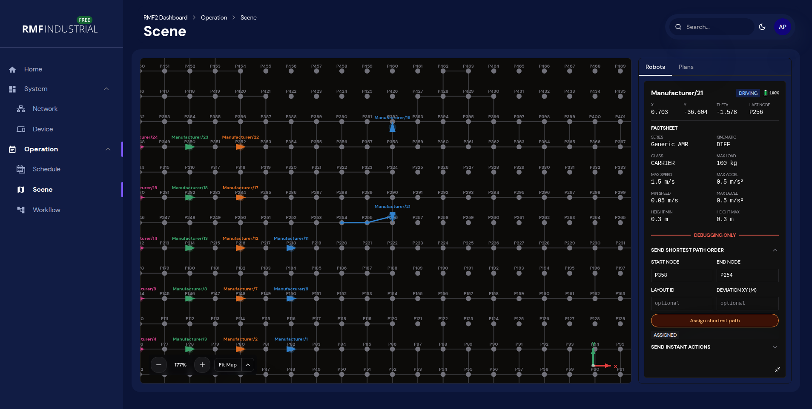
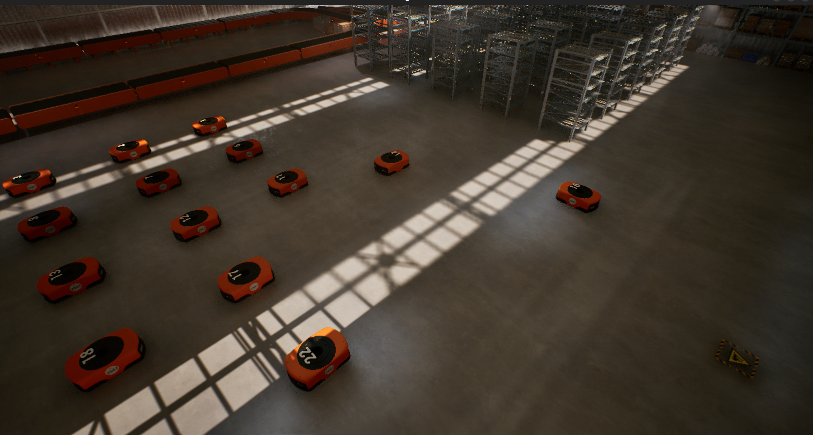

# The RMF Industrial Project

<p>
  
  
  
</p>

The RMF Industrial project provides RMF services for Manufacturing and Logistics.


## Summary

The RMF Industrial project tries to adopt the new [Next Gen RMF interfaces](https://github.com/open-rmf/next_gen_prototype)
and provides a suite of open source modules for industrial users
to build planning, scheduling and orchestration in large-scale simulated facility,
showcasing RMF’s flexibility, scalability in multi-robot coordination.

## Documentation

The hosted documentation is available at <https://dev.rmf-industrial.org/latest>.

## RMF Industrial Modules

| Module Name | Repositories |
| - | - |
| RMF Industrial | <https://github.com/ros-industrial/rmf_industrial> |
| Documentation | <https://github.com/ros-industrial/rmf2-docs> |
| VDA5050 Library and support tools | <https://github.com/ros-industrial/vda5050_core><br> <https://github.com/ros-industrial/vda5050_interfaces> |
| Unreal Engine Plugins | <https://github.com/ros-industrial/rmf2-unreal> |
| MAPF Robot Execution System (RES) | <https://github.com/ros-industrial/res_mapf> |
| Task Orchestrator | <https://github.com/ros-industrial/rmf2_task_orchestrator> |
| Task Scheduler | <https://github.com/ros-industrial/rmf2_scheduler> |
| Web UI | <https://github.com/ros-industrial/rmf2-ui> |


## Setup Instructions

Clone the `rmf_industrial` repo to your home folder (use `release-v0.2.0rc1` branch as of 20 Oct 2026).

```bash
git clone git@github.com:Briancbn/rmf_industrial.git
cd ~/rmf_industrial

git switch --track -c release-v0.2.0rc1 origin/release-v0.2.0rc1
```

### Build the image

```bash
cd ~/rmf_industrial
docker compose -f docker-compose.dev.yml up -d
```
### ⚠️ Port conflicts

The stack publishes the host ports below. If a previous run — or any other process (your own Postgres, Redis, RabbitMQ, Mosquitto, etc.) — is already holding one of them, startup will fail. Before starting, make sure they are free.

The launcher gates on four of these; a conflict on any **gate port** halts startup:

| Step              | Service       | Gate port | Other host ports bound |
| ----------------- | ------------- | --------- | ----------------       |
| Dashboard         | rmf2-launcher | **8083**  | —                      |
| Broker (IOCS)     | Swagger / API | **8000**  | 1026 (Orion), 9090 (Scorpio), 5432 (Postgres), 5431 (logger DB), 6379 (Redis), 5672 (RabbitMQ), 15672 (RabbitMQ UI), 27016 (Mongo), 8001 (connector), 8002 (event mgr), 8003 (RMF proxy), 8004 (logger), 8084 (monitor), 9999 (nginx proxy) |
| MQTT              | Mosquitto     | —         | 1883–1888  |
| MAPF (unified)    | solver        | **8888**  | 7073 (map server), 6333 (AGV state), 1932 (ADG MQTT), 1933 (MRS MQTT)  |
| Task Orchestrator | HTTP API      | **2727**  | —    |
| Devices (VDA5050) | FIWARE bridge | —         | 1928  |

You MUST ensure every port below is free before starting — each command should return
nothing. Stop or remove whatever shows up.

```bash
sudo lsof -i :8083 -i :8000 -i :8001 -i :8002 -i :8003 -i :8004 -i :8084 \
          -i :8888 -i :2727 -i :1026 -i :9090 -i :9999 \
          -i :5431 -i :5432 -i :5672 -i :15672 -i :6379 -i :27016 \
          -i :7073 -i :6333 \
          -i :1883 -i :1884 -i :1885 -i :1886 -i :1887 -i :1888 \
          -i :1928 -i :1932 -i :1933
```

What it does, in order (see [Launch Scripts](/guide/launch-scripts) for the full table)

## Demonstrations

### Warehouse Simulation

<table>
  <thead>
    <tr>
      <th>
        
      </th>
    </tr>
  </thead>
  <tbody>
    <tr>
      <td>
        <p align="center">
          Warehouse Demonstration
          (<a href="https://downloads.rmf-industrial.org/UE5Demos/RMF2_SIM_20260611.zip">Download Link</a>)
        </p>
      </td>
    </tr>
  </tbody>
</table>

#### Simulation Setup

Download and unpack the latest UE5 simulation build in your home folder:

```bash
curl -OL https://downloads.rmf-industrial.org/UE5Demos/RMF2_SIM_v0.2.0.zip

unzip RMF2_SIM_0.2.0.zip
```

Start the simulation

```sh
cd ~/RMF2_SIM_v0.2.0
./Linux/RMF2_SIM.sh
```

The simulation should start full screen matching your screen resolution.  
You can press `Alt + Enter` to toggle between fullscreen and windowed mode.
You can also start the simulation in a windowed mode with specific resolution

```sh
./Linux/RMF2_SIM.sh -windowed -resx 1920 -resy 1080
```

The simulation controls are similar to a typical game.
Here are the basics

- Movement: Keyboard `W A S D` or Controller Left Stick
  - `W`, `S` move forward and backward
  - `A`, `D` pan left and right
  - `Q`, `E` move up and down

  View: Mouse  or Controller Right Stick
  - click on the screen and hold to move around

Other controls
- Tab `M` to show Map marker


#### Usage



WebUI grid showing realtime positions of the robots.



Simulation showing realtime positions of the robots.
